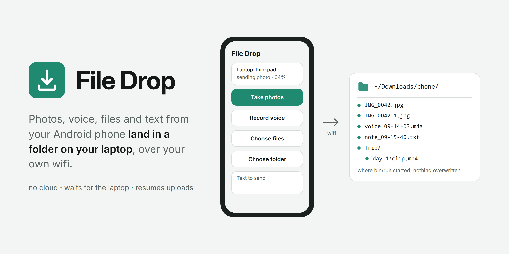

<picture>
  <source media="(prefers-color-scheme: dark)" srcset="img/cover-dark.png">
  
</picture>

# file-drop

An Android app that only sends: photos, voice notes, files, folders and text go from the phone to a folder on your laptop over home wifi.

Take photos, record a voice note, pick files or a whole folder, type a
text, and it all lands in a folder on your laptop. No cloud, no cable, no
account. The laptop runs a small server on the home wifi; the app finds it
by itself, keeps everything on the phone while the laptop is away, and
sends it the moment the laptop is back.

## Start

    bin/configure
    bin/build
    cd ~/Downloads/phone
    /path/to/file-drop/bin/run

`bin/run` starts the server; Ctrl-C stops it. Files land in the directory
it was started from, under their own names; a name already taken gets
`_1`, `_2`, and nothing is overwritten. The startup log prints the URL to
open on the phone, where the page links to the app.

## Documentation

Full documentation: **[docs/](docs/)**

* [Phone](docs/phone.md) — install the app, and what each button does
* [Server](docs/server.md) — the folder, ports, running without docker
* [Android app](docs/android.md) — the build, updates, the keystore
* [How sending works](docs/protocol.md) — the outbox, resumable uploads, discovery
* [Troubleshooting](docs/troubleshooting.md) — no laptop found, files waiting, an update that will not install

## License

[MIT](LICENSE)
